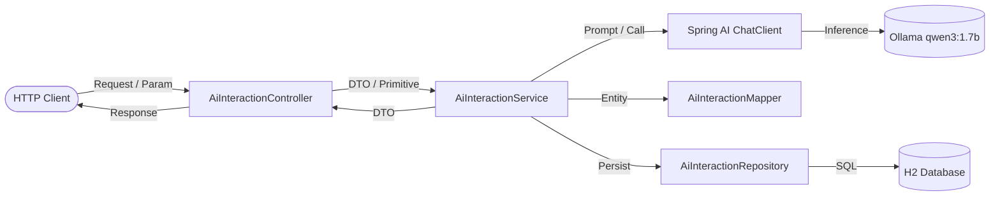

# Spring AI + Ollama Base Project (`spring-ai`)

[](https://spring.io/projects/spring-boot)
[](https://spring.io/projects/spring-ai)
[](https://openjdk.org/projects/jdk/25/)
[](https://ollama.com/)
[](https://www.h2database.com/)
[]()

Welcome to the **`spring-ai`** reference application. This project demonstrates enterprise best practices for building applications powered by **Spring Boot 4.1.0**, **Java 25 (LTS)**, and **Spring AI 2.0.1**, integrated seamlessly with a local **Ollama** model (`qwen3:1.7b`).

It adheres to a strict, decoupled **layered architecture**, separating REST controllers, service contracts, data persistence (Spring Data JPA), entity mappers, and immutable Java record DTOs.

---

## 📑 Table of Contents

- [1. Executive Summary & Tech Stack](#1-executive-summary--tech-stack)
- [2. Core Capabilities & AI Features](#2-core-capabilities--ai-features)
- [3. Architecture & Directory Structure](#3-architecture--directory-structure)
- [4. Configuration (`application.properties`)](#4-configuration-applicationproperties)
- [5. API Endpoints Reference & cURL Examples](#5-api-endpoints-reference--curl-examples)
- [6. Prerequisites & Local Execution](#6-prerequisites--local-execution)
- [7. Automated Testing Suite](#7-automated-testing-suite)
- [8. Governance & Development Standards](#8-governance--development-standards)

---

## 1. Executive Summary & Tech Stack

| Parameter | Specification |
| :--- | :--- |
| **Project Name** | `spring-ai` |
| **Group ID** | `com.venefast.springboot` |
| **Artifact ID** | `spring-ai` |
| **Base Package** | `com.venefast.springboot.springai.app` |
| **Java Version** | **Java 25 (LTS)** |
| **Spring Boot** | **4.1.0** |
| **Spring AI** | **2.0.1** (BOM-managed) |
| **AI Provider** | **Ollama** (`spring-ai-starter-model-ollama`) |
| **Active Model** | `qwen3:1.7b` (on `http://localhost:11434`) |
| **Server Port** | `8090` |
| **Database** | H2 In-Memory (`jdbc:h2:mem:spring_ai_db`) with Web Console at `/h2-console` |
| **Build Tool** | Maven with Maven Wrapper (`./mvnw`, `mvnw.cmd`) |

---

## 2. Core Capabilities & AI Features

1. **Direct, Stateless Prompting (GET)**:
   - Rapid HTTP GET endpoints that accept query parameters, invoke the Spring AI `ChatClient` inside the service layer, and return raw plain-text completions with minimal latency and no unnecessary overhead.
2. **System Instruction & Multilingual Personas**:
   - Advanced fluent prompt orchestration using `.system(...)` and `.user(...)` method chaining:
     - Enforces single-line French responses.
     - Custom persona conditioning.
     - Dynamic user parameter greetings.
3. **Persistent AI Interactions & Auditing (POST)**:
   - Full transactional persistence workflow: validates user input (`@Valid`), calls the LLM, and persists the prompt, completion, model used, and timestamps (`createdAt`, `updatedAt`) in an H2 relational table.
4. **History & Interaction Lookup**:
   - Query the 10 most recent persistent interactions or fetch a specific interaction by its unique database identifier.
5. **Centralized REST Error Handling**:
   - Uniform error payload contracts across the API for missing resources (`404`), validation errors (`400`), and unexpected server errors (`500`).

---

## 3. Architecture & Directory Structure

The project implements a strict layered architecture:

```
src/main/java/com/venefast/springboot/springai/app/
├── SpringAiApplication.java                     # Application bootstrap
├── config/
│   └── AiConfig.java                            # Spring AI ChatClient Bean definition
├── controllers/
│   └── AiInteractionController.java             # REST controller (/api/v1/ai)
├── exceptions/
│   ├── ResourceNotFoundException.java           # Domain exception
│   └── GlobalExceptionHandler.java              # Centralized @RestControllerAdvice
├── mappers/
│   └── AiInteractionMapper.java                 # Bidirectional Entity <-> DTO conversion (@Component)
├── models/
│   ├── dtos/
│   │   ├── AiPromptRequestDto.java              # Input validation record
│   │   └── AiInteractionDto.java                # Immutable client record
│   └── entities/
│       └── AiInteraction.java                   # JPA Entity (ai_interactions table)
├── repositories/
│   └── AiInteractionRepository.java             # Spring Data JPA Repository
└── services/
    ├── AiInteractionService.java                # Business service contract
    └── impl/
        └── AiInteractionServiceImpl.java        # Business logic, ChatClient & transaction orchestration
```

### Layer Responsibilities



- **Controllers**: Thin presentation boundary. Strictly delegates execution to the service layer. Never interacts directly with database entities or the `ChatClient`.
- **Services**: Owns domain rules, `ChatClient` orchestration, and transaction demarcations (`@Transactional`).
- **Mappers**: Dedicated Spring `@Component` decoupling JPA entities from immutable DTO records.
- **DTOs**: Java `record` types omitting sensitive and internal audit fields.
- **Repositories**: Standard Spring Data `JpaRepository<Entity, ID>` interfaces.
- **Entities**: JPA models with automated `@PrePersist` and `@PreUpdate` timestamp auditing.

---

## 4. Configuration (`application.properties`)

Configuration is maintained exclusively in `src/main/resources/application.properties` (never YAML):

```properties
# Application Configuration
spring.application.name=spring-ai
server.port=8090

# Spring AI Ollama Configuration
spring.ai.ollama.base-url=http://localhost:11434
spring.ai.ollama.chat.model=qwen3:1.7b
spring.ai.ollama.chat.options.model=qwen3:1.7b

# H2 Database & Console Configuration
spring.datasource.url=jdbc:h2:mem:spring_ai_db;DB_CLOSE_DELAY=-1;DB_CLOSE_ON_EXIT=FALSE
spring.datasource.driver-class-name=org.h2.Driver
spring.datasource.username=sa
spring.datasource.password=
spring.h2.console.enabled=true
spring.h2.console.path=/h2-console

# JPA / Hibernate Configuration
spring.jpa.open-in-view=false
spring.jpa.hibernate.ddl-auto=update
spring.jpa.show-sql=true
spring.jpa.properties.hibernate.format_sql=true

# Actuator Configuration
management.endpoints.web.exposure.include=health,info,metrics
management.endpoint.health.show-details=always
```

---

## 5. API Endpoints Reference & cURL Examples

Base path: `http://localhost:8090/api/v1/ai`

### 5.1 Stateless GET Endpoints (Direct String Completions)

#### 1. General Question (`/generate` / `/ask`)
- **Method**: `GET`
- **Path**: `/api/v1/ai/generate` (or `/api/v1/ai/ask`)
- **Query Params**: `message` (Default: `"is it worth to lear spring AI?"`)
- **cURL**:
  ```bash
  curl -G "http://localhost:8090/api/v1/ai/generate" --data-urlencode "message=Explain Java records in one sentence"
  ```

#### 2. Personalized Name Greeting (`/greet` / `/name`)
- **Method**: `GET`
- **Path**: `/api/v1/ai/greet` (or `/api/v1/ai/name`)
- **Query Params**: `name` (Default: `"Developer Jhon"`)
- **cURL**:
  ```bash
  curl -G "http://localhost:8090/api/v1/ai/greet" --data-urlencode "name=Carlos"
  ```

#### 3. French Greeting with Last Name (`/last-name` / `/lastname`)
- **Method**: `GET`
- **Path**: `/api/v1/ai/last-name` (or `/api/v1/ai/lastname`)
- **Query Params**: `lastName` or `lastname` (Default: `"Doe"`)
- **Special Rule**: Injects system instruction `"Always answer in French, in one line."` and user prompt `"Hello world " + lastName`.
- **cURL**:
  ```bash
  curl -G "http://localhost:8090/api/v1/ai/last-name" --data-urlencode "lastName=Duarte"
  ```

---

### 5.2 Stateful & Persistent Endpoints (JSON DTOs)

#### 4. Generate & Save Interaction (`POST /generate`)
- **Method**: `POST`
- **Path**: `/api/v1/ai/generate`
- **Headers**: `Content-Type: application/json`
- **Body**:
  ```json
  {
    "prompt": "What are the core components of Spring AI?",
    "model": "qwen3:1.7b"
  }
  ```
- **cURL**:
  ```bash
  curl -X POST http://localhost:8090/api/v1/ai/generate \
    -H "Content-Type: application/json" \
    -d "{\"prompt\": \"What are the core components of Spring AI?\"}"
  ```
- **Response** (`201 Created` with `Location: /api/v1/ai/{id}`):
  ```json
  {
    "id": 1,
    "prompt": "What are the core components of Spring AI?",
    "response": "Spring AI provides portable abstractions such as ChatClient, Prompt, and Advisors...",
    "model": "qwen3:1.7b"
  }
  ```

#### 5. Retrieve Interaction History (`GET /history`)
- **Method**: `GET`
- **Path**: `/api/v1/ai/history`
- **Returns**: Array of up to 10 most recent persistent interactions.
- **cURL**:
  ```bash
  curl http://localhost:8090/api/v1/ai/history
  ```

#### 6. Retrieve Interaction by ID (`GET /{id}`)
- **Method**: `GET`
- **Path**: `/api/v1/ai/{id}`
- **cURL**:
  ```bash
  curl http://localhost:8090/api/v1/ai/1
  ```

---

### 5.3 Health & Management Endpoints

- **Health Endpoint**: `http://localhost:8090/actuator/health`
- **H2 Web Console**: `http://localhost:8090/h2-console`
  - **JDBC URL**: `jdbc:h2:mem:spring_ai_db`
  - **Username**: `sa`
  - **Password**: *(empty)*

---

## 6. Prerequisites & Local Execution

### 6.1 Prerequisites
1. **Java 25 SDK**:
   ```bash
   java -version
   ```
2. **Ollama**:
   Ensure Ollama is running with the target model:
   ```bash
   ollama run qwen3:1.7b
   ```

### 6.2 Running the Application
- **Windows**:
  ```cmd
  mvnw.cmd -DskipTests spring-boot:run
  ```
- **Linux / macOS**:
  ```bash
  ./mvnw -DskipTests spring-boot:run
  ```

---

## 7. Automated Testing Suite

Run the full automated test suite:
```cmd
mvnw.cmd test
```

### Coverage Overview (10 Automated Tests)
- **`AiInteractionControllerTest`** (6 tests): WebMvc mock slice tests validating routing, query parameter mapping, fallbacks, and service layer delegation.
- **`AiInteractionMapperTest`** (3 tests): Bidirectional entity/record transformation and null-safety unit tests.
- **`SpringAiApplicationTests`** (1 test): Spring Boot context bootstrapping test verifying bean wiring, Ollama auto-configuration, and Hikari / JPA initialization.

---

## 8. Governance & Development Standards

- **Code & Comments**: English only.
- **Communication & Docs**: English only.
- **Language Level**: Target Java 25 LTS features (Records, Pattern Matching, Switch Expressions).
- **Rule Book**: Refer to [`AGENTS.md`](./AGENTS.md) for full workspace policies and skill integration details.
